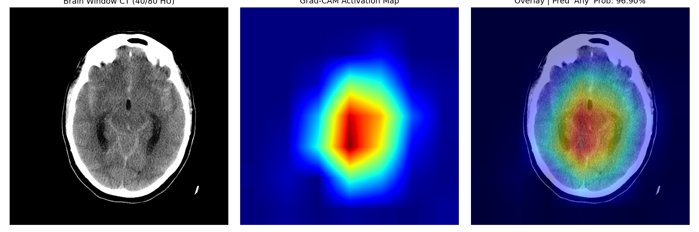

# Intracranial Hemorrhage Detection on Head CT Scans (RSNA)

A multi-label deep learning pipeline built with **PyTorch** and **pydicom** to detect and classify acute intracranial hemorrhage subtypes from raw head CT DICOM scans, complete with multi-window Hounsfield Unit (HU) preprocessing, class-imbalance weighting, precision-recall threshold calibration, and **Grad-CAM** visual explainability.



---

## Project Overview

Intracranial hemorrhage (ICH) is a life-threatening medical emergency requiring rapid localization and subtype identification on non-contrast head CT scans. This project processes raw DICOM medical images from the **RSNA Intracranial Hemorrhage Detection** dataset to predict probabilities across **6 target classes**:
1. **`any`** — Presence of any intracranial hemorrhage
2. **`epidural`** — Bleeding between the skull and dura mater
3. **`intraparenchymal`** — Bleeding within the brain tissue
4. **`intraventricular`** — Bleeding inside the brain's ventricular system
5. **`subarachnoid`** — Bleeding in the subarachnoid space
6. **`subdural`** — Bleeding beneath the dura mater

---

## Key Technical Highlights

* **Multi-Window Hounsfield Unit (HU) Stacking:** Converts raw DICOM pixel arrays into calibrated Hounsfield Units using `RescaleSlope` and `RescaleIntercept`, stacking three clinically relevant CT windows into a 3-channel input tensor:
  * **Channel 0 — Brain Window (`WL: 40, WW: 80`):** Highlights acute parenchymal blood and soft tissue contrast.
  * **Channel 1 — Subdural Window (`WL: 80, WW: 200`):** Separates extra-axial blood collections from the inner skull table.
  * **Channel 2 — Bone Window (`WL: 600, WW: 2800`):** Preserves skull fracture and high-density calcification context.
* **Leakage-Free Patient Split:** Uses `GroupShuffleSplit` grouped by `PatientID` (80/20 split across 600 patients / 916 CT slices) so axial slices from the same patient never overlap between training and validation sets.
* **Imbalance-Aware Loss Function:** Addresses severe clinical class imbalance (~14% overall positive slices; <0.5% epidural) via inverse-frequency `pos_weight` scaling inside `BCEWithLogitsLoss` combined with competition class weighting (`2.0` for `any`, `1.0` for subtypes).
* **Threshold Calibration & Explainability:** Tunes per-subtype operating thresholds via Precision-Recall curves and extracts **Grad-CAM** activation overlays from ResNet50's final convolutional block (`layer4`) to visually verify lesion localization.

---

## Validation Results

Evaluated on held-out patient CT slices after 5 epochs of fine-tuning a pretrained **ResNet50** backbone with `AdamW` and cosine annealing:

| Target Class | Validation Positives | ROC-AUC | Optimal Threshold | F1-Score |
| :--- | :---: | :---: | :---: | :---: |
| **`any` (Overall Bleed)** | 28 | **0.8333** | 0.2517 | 0.5484 |
| **`epidural`** | 2 | **0.7995** | 0.0166 | 0.0851 |
| **`intraparenchymal`** | 9 | **0.7606** | 0.4634 | 0.5263 |
| **`intraventricular`** | 6 | **0.7893** | 0.6130 | 0.4444 |
| **`subarachnoid`** | 12 | **0.8517** | 0.5167 | 0.4800 |
| **`subdural`** | 7 | **0.8144** | 0.4967 | 0.3636 |


Dataset: RSNA Intracranial Hemorrhage Detection (Kaggle) — used strictly for non-commercial research and educational purposes; no patient DICOM files are redistributed in this repository."
---

## Repository Structure

```text
brain-bleed-ct-detection/
├── brain_bleed_detection.ipynb   # End-to-end DICOM preprocessing, training, Grad-CAM & threshold calibration
├── gradcam_brain_bleed.png       # Sample Brain Window CT vs. Grad-CAM activation overlay
└── README.md                     # Project documentation and benchmark metrics


Tech Stack
Deep Learning: PyTorch, Torchvision (ResNet50)

Medical Imaging & Vision: pydicom, OpenCV (cv2), Matplotlib

Data Processing & Metrics: Pandas, NumPy, Scikit-learn (GroupShuffleSplit, roc_auc_score, precision_recall_curve)

How to Run
Open brain_bleed_detection.ipynb in Kaggle Notebooks (with GPU T4/P100 enabled) or Google Colab.

Attach the RSNA Intracranial Hemorrhage Detection competition dataset.

Install dependencies if running outside Kaggle:

Bash
pip install pydicom torch torchvision scikit-learn opencv-python pandas numpy matplotlib
Execute cells sequentially to build the patient-grouped subset, train the multi-window ResNet50 classifier, generate Grad-CAM visualizations, and compute per-subtype ROC-AUC and calibrated thresholds.

Author
Priya Pandey — MCA Student & AI/ML Developer

GitHub: @priyapandey5
